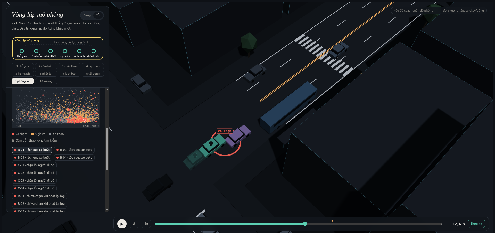
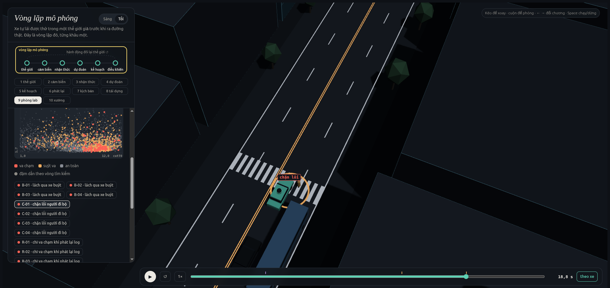
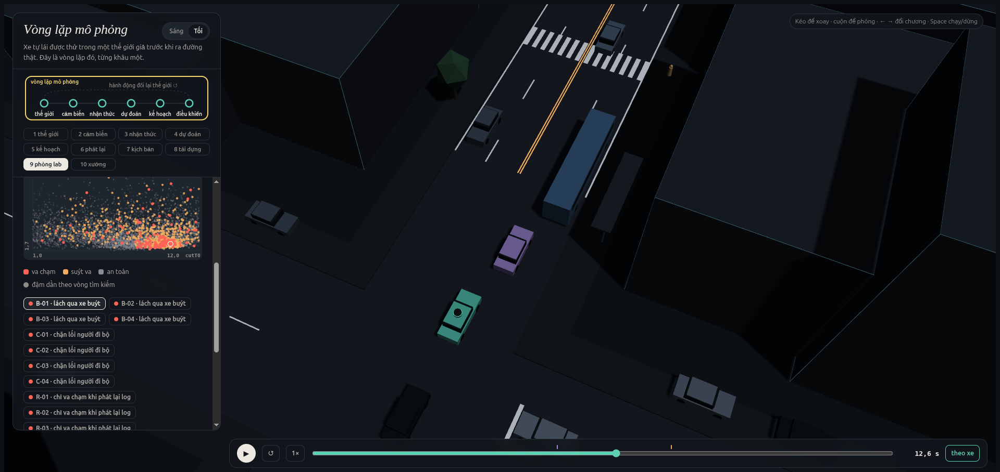

MSSV: 202602467

# Lab 11 · Scenario Forge — báo cáo

Mỗi câu: trả lời ngắn, **trích số từ `evidence/`** (ghi tên file và trường, ví dụ `mc.json: crashes = 4`). Grader chạy lại với MSSV của bạn; số không khớp `evidence/` thì mất điểm phần D (RUBRIC), và câu dựa trên số sai khó được điểm đầy đủ. Không cần văn hay: một bảng nhỏ và hai, ba câu giải thích là đủ.

Thị trấn của bạn (`meta.json: _run.town`): **A**

## 1. Phát lại log có trung thực không? (bước A)

`replay.json`: `n` = 400, `dropped_human_crash_logs` = 1 (bỏ vì chính người lái va chạm), `n_used` = 399.

| | va chạm | rear | side |
|---|---|---|---|
| phát lại (`replay`) | 124 | 113 | 11 |
| phản ứng (`reactive`) | 1 | 0 | 1 |

`crash_in_both` = 1, `replay_only` có 20 kịch bản (ví dụ #12, #14, #15: đều `rear`).

Vì sao phần lớn là `rear` và là va chạm **giả**: trong log, xe phía sau (TG) lái đúng như đã ghi với người lái thật. Planner của ta phanh sớm hơn người lái nhưng log không biết điều đó, nên xe sau vẫn không phanh theo và tông vào đuôi ta. Trong thế giới phản ứng, xe sau là IDM nên nhìn thấy ta phanh và giãn khoảng cách. Ví dụ kịch bản #12 (`replay_only`): va chạm `rear` ở log phát lại, còn trong thế giới phản ứng TTC nhỏ nhất vẫn là 2,61 s (`min_ttc_reactive`), tức không có nguy cơ thật.

## 2. Kịch bản bất khả thi (bước B)

Bốn luật trong `is_feasible` (`lab11/feasible.py`):
1. Đổi làn cần a_lat = (π/cutDur)²·3,5/2 > μg: vượt độ bám của lốp thì không xe nào làm được.
2. `cutBrake` > μg: không phanh mạnh hơn ma sát cho phép.
3. `pedV` > 2,5 m/s: người đi bộ không chạy nhanh vậy khi băng đường.
4. `cutV` ngoài (0, 22] m/s: xe đứng yên hoặc nhanh quá tốc độ của phố này.

Số kịch bản bất khả thi bị bỏ (`hunt.json: <kiểu>.infeasible`): `bus_bypass` 2, `cut_in` 4, `rear_ended` 4, **`crosswalk_block` 17** (nhiều nhất). CEM bị kéo về phía đó vì các giá trị cực đoan (người đi bộ chạy nhanh, đổi làn rất gấp) làm điểm nguy hiểm cao nhất. Trong `mc.json` có `infeasible` = 12 trên 3 000 lần rút tự nhiên. Nếu **đếm** chúng là va chạm thì ước lượng bị thổi phồng bằng những tình huống không thể xảy ra, và hunt "tìm thấy" lỗi không có thật.

## 3. Monte Carlo cho bạn biết gì (bước C1)

`mc.json`: k = 7, n = 3 000, p̂ = 2,33e-3, Wilson 95 % = [1,13e-3 ; 4,81e-3] (cả 7 là `bus_bypass`).

Để khoảng tin cậy hẹp còn ±20 % của p: n ≈ 1,96²/0,2² / p ≈ 96/p ≈ 96 / 2,33e-3 ≈ **41 000 lần chạy**, gấp ~14 lần ngân sách hiện tại.

Các kiểu chưa từng xuất hiện trong 3 000 lần: `cut_in`, `crosswalk_block`, `rear_ended`, `other` (đều k = 0). Con số đúng không phải 0 mà là cận trên Wilson 95 %: `mc.json: per_mode.<kiểu>.hi` = 1,28e-3.

## 4. Importance sampling, ESS và độ suy biến (bước C3)

`estimate.json` (`budget` = 16 800 lần chạy mô phỏng; n = 600 mẫu mỗi kiểu mỗi seed):

| seed | kiểu | p | hits | ess | top_share |
|---|---|---|---|---|---|
| 0 | bus_bypass | 3,74e-4 | 36 | 124 | 0,54 |
| 0 | crosswalk_block | 2,13e-7 | 96 | 137 | 0,36 |
| 1 | bus_bypass | 6,97e-4 | 67 | 119 | 0,48 |
| 1 | crosswalk_block | 2,95e-7 | 94 | 102 | 0,42 |
| 2 | bus_bypass | 1,64e-3 | 56 | 125 | 0,38 |
| 2 | crosswalk_block | 1,43e-6 | 119 | 128 | 0,48 |

`cut_in` và `rear_ended` ở cả 3 seed: p = 0, hits = 0, `upper_zero_hits` = 0,025 (cận trên, không phải 0). `total` theo seed: 3,74e-4 / 6,97e-4 / 1,64e-3.

Ba seed **không đồng ý** (chênh ~4,4 lần) và đều **thấp hơn** Monte Carlo (2,33e-3), đúng với cảnh báo "IS thường thấp hơn 1,5–4 lần". Seed 2 gần MC nhất. `top_share` > 0,5 chỉ ở seed 0 `bus_bypass` (0,54): hơn một nửa con số là trọng số của đúng một mẫu, nên ước lượng thực chất là một điểm. Các mẫu khác cũng gần 0,5, nên con số kém tin cậy.

So ngân sách: IS dùng 16 800 lần chạy (3 seed); để Monte Carlo có độ chính xác ±20 % tại p ≈ 1e-3 cần ~96/1e-3 ≈ 96 000 lần, và với `crosswalk_block` (p ~ 1e-7 đến 1e-6) cần hàng trăm triệu lần: IS rẻ hơn nhiều bậc, nhưng con số kém chắc. Phần `other` lấy từ Monte Carlo (`estimate.json: other` = k 0, n 3 000, p = 0, hi = 1,28e-3, source `mc.json`) vì nó không thuộc kiểu nào nên CEM không săn; tổng = các kiểu + `other`.

## 5. Các kiểu thất bại (bước C2 + 3D)

Kết quả `hunt.json: <cuộc săn>.found`:

| cuộc săn | tìm thấy |
|---|---|
| bus_bypass | bus_bypass 95 |
| cut_in | bus_bypass 52 (không có cut_in) |
| crosswalk_block | crosswalk_block 67, bus_bypass 1 |
| rear_ended | crosswalk_block 7, bus_bypass 4 (không có rear_ended) |

- **bus_bypass**: xe chuyển làn C2 (chậm, x < 112 m) lách qua xe buýt đỗ; xe ta không thấy nó đủ sớm vì xe buýt che, rồi đâm vào.
- **crosswalk_block**: người đi bộ P1 bước ra từ sau xe buýt đỗ; xe ta phanh gấp nhưng dừng khi thân xe còn nằm trên vạch, chặn lối người đi bộ.
- **cut_in và rear_ended**: cuộc săn **không tìm thấy**; chỉ là kết quả "chưa thấy", không phải bằng chứng không tồn tại. Cận trên 95 % là 2,5e-2 (`upper_zero_hits`) ở IS và 1,28e-3 ở Monte Carlo.

Nếu chỉ chạy một cuộc săn chung, CEM co về kiểu dễ nhất (`bus_bypass`, nó chiếm mặt `found` của cả `cut_in` lẫn `rear_ended`), và các kiểu hiếm như `crosswalk_block` sẽ không được khám phá.

Ảnh 3D (chương 9, `evidence/viewer.json`), chụp đúng lúc va chạm:

- `bus_bypass` B-01, t = 12,55 s:  Xe C2 lách qua xe buýt đỗ rồi đâm vào xe ta (nhãn "va chạm").
- `crosswalk_block` C-01, t = 18,75 s:  Xe ta dừng với thân xe nằm trên vạch qua đường, chặn người đi bộ (nhãn "chặn lối").

## 6. Sửa planner (bước E + 3D)

`fix.json`: policy được chọn bằng `choose_policy` trên TRAIN: `{"cutinLat": 3.0}`.

| | fail | fail_hi_seen | fail_hi (hợp lệ) | quãng đường (m) | phanh gấp |
|---|---|---|---|---|---|
| bản sửa, TRAIN (`chosen`) | 1,10e-7 | 2,11e-7 | 2,11e-7 | 212,5 | 7,94 |
| bản sửa, TEST (`chosen_test`) | 2,77e-8 | 4,54e-8 | **3,88e-2** | 214,6 | 7,80 |
| policy gốc, TEST (`baseline_test`) | 1,53e-3 | 3,69e-3 | 4,97e-3 | 214,6 | 8,47 |

Vì sao `fail_hi` của bản sửa (3,88e-2) lớn hơn `fail` của bản gốc (1,53e-3) dù bản sửa tốt hơn: kiểu `bus_bypass` được đánh dấu `unseen` (0 va chạm trên TEST), nên nó vẫn cộng cận trên 3/(0,2·n) ≈ 3,75e-2 vào `fail_hi`. Với n = 400, không thể chứng nhận được một kiểu đã biến mất. Bản sửa **có vẻ** tốt hơn (`fail_hi_seen` 4,54e-8 so với 3,69e-3), nhưng dữ liệu không đủ để chứng nhận.

Nhắc thêm: `choose_policy` chọn bản này vì mọi ứng viên có `cutinLat` ≥ 3,0 đều có TRAIN `fail_hi` = 0 do `unseen`: đúng cái bẫy README cảnh báo. Con số nên tin là TEST, không phải TRAIN.

Núm "nghe an toàn hơn" nhưng tệ hơn: `T` = 2,0 (giãn khoảng cách theo sau) có `fail_hi` TRAIN = 6,48e-4, cao hơn policy gốc (3,42e-4). Giải thích khả dĩ: xe chuyển làn chờ một khe đủ rộng (gap acceptance), nên khoảng trống lớn hơn trước mặt ta mời xe C2 chen vào sớm hơn và gần hơn. Đây là suy luận từ cơ chế, chưa tách riêng để kiểm chứng.

Ảnh 3D với policy sửa (`cutinLat` = 3,0) trên kịch bản B-01 (nạp `evidence/shots/viewer_fixed_policy.json`, bản `viewer.json` đổi policy của các lần chạy `bus_bypass` sang bản sửa), t = 12,6 s:  Cùng kịch bản mà policy gốc đâm C2 lúc 12,55 s, bản sửa không va chạm. Lưu ý: bóng mờ của policy gốc **không thấy rõ** trong ảnh này.

## 7. Từ mô phỏng ra đường thật

Ba giả định ảnh hưởng nhiều nhất (`avsim/space.py`):

1. **Khe chấp nhận của xe chuyển làn** (`cutGap`, log-chuẩn, trung vị 12 m). Dữ liệu thay thế: quỹ đạo cut-in từ bộ dữ liệu giao thông (như highD hoặc NGSIM) hoặc log đội xe tại đúng loại đường. Nếu khe thật hẹp hơn thì va chạm thật **nhiều hơn** con số của ta.
2. **Tỉ lệ người đi bộ ngó qua xe buýt** (`pedLook` = 0,85). Dữ liệu: video camera ở các điểm băng ngang có xe buýt đỗ, đếm hành vi nhìn trước khi bước. Nếu thật sự ít ngó hơn thì `crosswalk_block` và va chạm với người đi bộ **nhiều hơn**.
3. **Ma sát đường ướt** (`mu` = 0,5 khi ướt, 0,8 khi khô, tỉ lệ ướt do thị trấn). Dữ liệu: thống kê thời tiết địa phương và đo ma sát mặt đường. Nếu đường ướt hơn hoặc trơn hơn, quãng phanh dài ra và con số **thấp hơn thực tế**.

## 8. Giới hạn

Xác suất đã báo **không** nói:
1. Thế giới chỉ có một con phố với đúng một xe buýt, một người đi bộ, một xe chuyển làn: không có giao lộ, đèn đỏ, xe máy, xe đạp, thời tiết ngoài hai mức ma sát.
2. Mọi người lái khác là IDM (đã điều chỉnh): người lái thật hung hăng, xao nhãng hoặc phá luật, nên các kiểu như `rear_ended` có thể hiếm sai khác.
3. Cảm biến của ta hoàn hảo trừ phần bị xe buýt che, và chỉ phanh được (không đánh lái); IS cho con số thấp hơn thật 1,5–4 lần và các seed lệch nhau (3,74e-4 đến 1,64e-3), nên chỉ nên tin bậc độ lớn.

Nếu được thêm một tuần: đo lại trên ~10⁵ lần chạy Monte Carlo trực tiếp quanh vùng `bus_bypass`, thêm cuộc săn có nhiều seed hơn cho `crosswalk_block`, và hiệu chỉnh các phân phối bằng dữ liệu thật như ở câu 7.

## 9. Rắc rối của bạn (bước G + chương 10)

- **Rắc rối:** một **xe chết máy** đứng yên trong làn của xe ta (`hazard.json`: `stalled`, `lane` E2, `x` = 60 m). Ngoài đời: xe hỏng hoặc đỗ sai chắn làn.
- **Căn cứ:** xe đứng yên không có tín hiệu di chuyển, planner có thể phản ứng muộn, và nó còn làm lệch hành vi của xe chuyển làn C2 phía sau. Trong cảnh gốc (x = 60), planner tông C2 lúc 6,2 s (`mine.json: exact.planner`), nên tôi nghi ngờ sự tương tác này.
- **Giả định:** `space.h0_x` = [20, 140] m; `exposure` = 0,005 chuyến⁻¹ là **giả định dạy học** (khoảng 1 lần gặp xe chắn làn trên 200 chuyến đô thị), không có dữ liệu thật trong lab (`hazard.json: why`).
- **Kết quả** (`mine.json`), 1 494 phiên bản khả thi trên 1 500 (`accepted` = 0,996; `n` = 1 266 sau khi bỏ 228 phiên bản có xe chết máy trùng vị trí xe ta lúc đầu):

| | crashes | avoidable | unavoidable | unattributed | low_speed |
|---|---|---|---|---|---|
| policy gốc | 0 | 0 | 0 | 0 | 0 |
| policy chọn ở bước E | 0 | 0 | 0 | 0 | 0 |

  P(lỗi planner | rắc rối) = 0, Wilson 95 % = [0 ; 3,03e-3]; tần suất mỗi chuyến = 0,005 × cận trên 3,03e-3 = **1,51e-5** (`per_trip_hi`), thấp hơn nhiều so với tần suất lách xe buýt (Monte Carlo 2,33e-3).
- **Hình:** chưa chụp ảnh chương 9/10 cho rắc rối này (sweep không có va chạm nào để chụp; cảnh gốc x = 60 chưa dựng lại trong chương 10).
- **Bạn tự lái thì sao:** chưa thử tự lái.
- **Cách sửa:** không cần núm nào: planner đã xử lý tốt rắc rối này trên dải [20, 140] m (đây cũng là một kết quả). Cận trên 3,03e-3 với n = 1 266 không phải bằng chứng an toàn tuyệt đối. Lưu ý "tránh được" là chuẩn lạc quan: nó cho phanh hết cỡ ngay khi thấy, nên đếm nhiều hơn số va chạm một planner thật tránh được, nhưng cũng chỉ thử phanh nên đếm ít đi so với khi được đánh lái. Còn cảnh gốc (x = 60) cho thấy một va chạm `ego`–`C2` khi xe chết máy chắn làn; nếu muốn sửa cần thêm logic dự đoán xe chuyển làn có thể chen vào khi ta bị ép về một phía.

